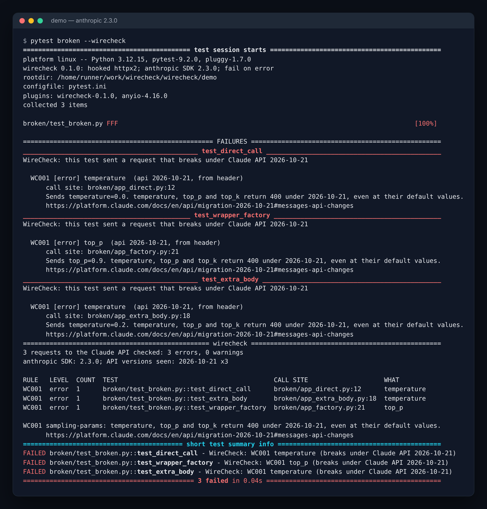

# WireCheck

**Your tests pass. Your Claude API calls return 400. WireCheck checks what your code really sends to the Claude API in tests, and fails the build if a request would break under API version 2026-10-21.**



[PyPI: pytest-wirecheck](https://pypi.org/project/pytest-wirecheck/) · [GitHub Marketplace: WireCheck for Claude API](https://github.com/marketplace/actions/wirecheck-for-claude-api) · [Demo](demo/)

## Why

On 21 Oct 2026 Anthropic released Claude API version `2026-10-21`. The new SDK majors (Python `anthropic` 2.0.0 and later) send it by default. Under it, a Messages request that sends `temperature`, `top_p` or `top_k` returns **400, even at the default value** ([migration guide](https://platform.claude.com/docs/en/api/migration-2026-10-21)).

Most test suites mock the API, so they never see that 400. And most of these parameters do not sit in the call you would grep for. They hide in a shared wrapper, a defaults dict, or `extra_body`. That is exactly how [Nojoin broke](https://github.com/Valtora/Nojoin/issues/554): a loose version floor pulled in `anthropic` 2.x, a wrapper still sent `temperature: 0.2` through `extra_body`, and the tests mocked the client, so they all passed.

WireCheck looks at the final request as it leaves the HTTP client, after the SDK has merged every wrapper, default and `extra_body`.

## Quick start

```bash
pip install pytest-wirecheck
pytest --wirecheck
```

A test that sends a breaking request now fails, and the run ends with a short report:

```
RULE   LEVEL  COUNT  TEST                                CALL SITE                     WHAT
WC001  error  1      broken/test_broken.py::test_extra_body  broken/app_extra_body.py:18  temperature
```

Each row shows the rule, the test that sent the request, and the file and line in your code that made the call.

### GitHub Action

```yaml
name: WireCheck
on: pull_request
permissions:
  contents: read
  pull-requests: write   # to post the findings comment
jobs:
  wirecheck:
    runs-on: ubuntu-latest
    steps:
      - uses: actions/checkout@v7
      - uses: actions/setup-python@v7
        with:
          python-version: "3.12"
      - run: pip install -e ".[test]"        # your project and its test deps
      - uses: ishanyash/wirecheck@v0.1.0
        with:
          pytest-args: tests/
```

The Action runs the static scan and your tests with `--wirecheck`, writes the findings to the job summary, and posts **one** pull request comment with a findings table (it updates the same comment on later pushes).

| Input | Default | Meaning |
|---|---|---|
| `path` | `.` | Folders for the static scan |
| `run-pytest` | `true` | Run `pytest --wirecheck` |
| `pytest-args` | | Extra pytest arguments |
| `working-directory` | `.` | Where to run |
| `fail-on` | `error` | `error`, `warn` or `never` |
| `comment` | `true` | Post the PR comment |
| `install` | `action` | `action` installs WireCheck from the tagged Action source; `skip` if you install it yourself |

## What it checks

Rules come from the [migration guide](https://platform.claude.com/docs/en/api/migration-2026-10-21) and the [release notes](https://platform.claude.com/docs/en/release-notes/overview).

**In the real requests your tests send (`pytest --wirecheck`):**

| Rule | What | Level |
|---|---|---|
| WC001 | `temperature`, `top_p` or `top_k` in a Messages, token count or batch request | error on 2026-10-21 |
| WC002 | `document` block directly in an `assistant` message | error on 2026-10-21 |
| WC003 | `text` block with non-empty `citations` in a `user` message, including inside `search_result` | error on 2026-10-21 |
| WC004 | `X-Api-Key` header set by your code. SDK 2.x sends `Authorization: Bearer`, so your key no longer replaces the client key (both are sent) | warning |
| WC005 | `claude-opus-4-8` with `speed: "fast"` | warning now, error from 2026-11-30 |

**In source (`wirecheck scan`):**

| Rule | What | Level |
|---|---|---|
| WCS001 | `MessageParam(...)` / `BetaMessageParam(...)` called or subclassed (TypeError in SDK 2.x) | error |
| WCS002 | `X-Api-Key` in `extra_headers` / `default_headers` | warning |
| WCS003 | `ant --api-key` / `ant --auth-token` (removed in the `ant` CLI 2.0.0) | error |
| WCS004 | Text Completions calls (`client.completions.create`, `/v1/complete`) | error |
| WCS005 | `temperature` / `top_p` / `top_k` visible in a Messages call (a hint; the runtime check is the real one) | warning |

```bash
wirecheck scan .                 # text
wirecheck scan src --format json # or markdown
```

## Which API version applies

For each request WireCheck reads the `anthropic-version` header. If there is none, it uses the installed SDK (`anthropic` 2.0.0 and later means `2026-10-21`).

- On `2026-10-21`, WC001 to WC003 are **errors** and fail the test that sent the request.
- On `2023-06-01` (SDK 1.x and older), the same findings are **warnings**. Your code works today and breaks when you upgrade. Use `--wirecheck-fail-on=warn` to fail on them now.

## How it works

When enabled, the plugin wraps `Client.send` and `AsyncClient.send` of `httpx2` (used by `anthropic` 1.x and 2.x) and `httpx` (older SDKs). Every request to `api.anthropic.com`, `$ANTHROPIC_BASE_URL` or a `--wirecheck-base-url` is recorded before it reaches the transport, so it is seen even when the test mocks the response with a mock transport, `respx`, or the `wirecheck_stub` fixture, and even when there is no network. API keys are redacted before anything is stored. The hook is removed when the run ends.

## Options

| Option | Meaning |
|---|---|
| `--wirecheck` | Turn it on (or `wirecheck = true` in your pytest ini, or `WIRECHECK=1`) |
| `--wirecheck-fail-on` | `error` (default), `warn`, or `never` |
| `--wirecheck-base-url URL` | Also capture a gateway or proxy URL (repeatable) |
| `--wirecheck-report PATH` | Write findings as JSON |
| `--wirecheck-markdown PATH` | Write findings as Markdown |
| `WIRECHECK_TODAY=YYYY-MM-DD` | Pin the date used by date-based rules |

Fixtures and markers:

- `wirecheck_stub` answers every Claude API request in a test with a canned reply, with no network. It mocks the response, not the client, so WireCheck still sees what you send. Set `wirecheck_stub["text"]` to change the reply.
- `wirecheck_requests` lists the requests the current test sent.
- `@pytest.mark.wirecheck_skip` ignores requests from one test.

## Known limits

- **It only sees requests that are really built.** If a test replaces `client.messages.create` (or the whole client) with a `MagicMock`, no request exists and WireCheck sees nothing. It prints a hint when a run captured no requests. Mock the HTTP response instead.
- Python only, and only the `httpx` / `httpx2` HTTP clients (the SDK default). The optional `aiohttp` backend is not hooked.
- Bedrock and Vertex requests go to other hosts and carry the version differently. Add their URL with `--wirecheck-base-url` if you want them recorded; version detection there falls back to the SDK version.
- `wirecheck_stub` answers non-streaming calls only.
- With `pytest-xdist`, each worker checks and fails its own tests, but `--wirecheck-report` is written per worker, so give each run its own path.
- WC003 checks the places the guide names (user `text` blocks and `search_result` blocks). It does not flag bare `text` blocks inside `tool_result`, because the guide does not say.
- The static scanner is a set of simple patterns. It misses anything assembled at runtime, which is why the pytest plugin exists.
- No auto-fix and no TypeScript or other SDKs in v0.1.

## Licence

MIT. See [LICENSE](LICENSE).

---

Built by [Ishan Yash](https://ishanyash.com)
